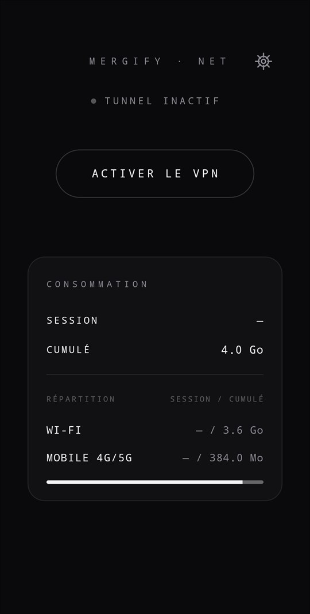
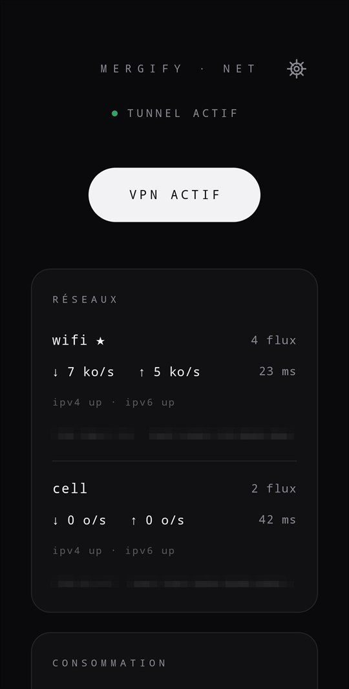
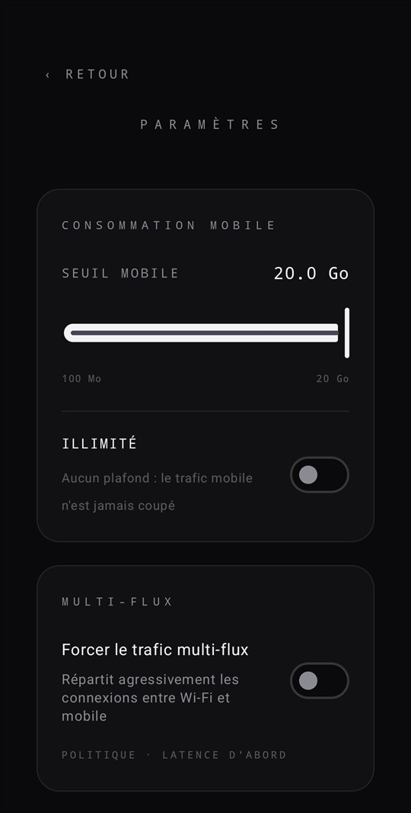
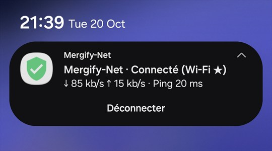
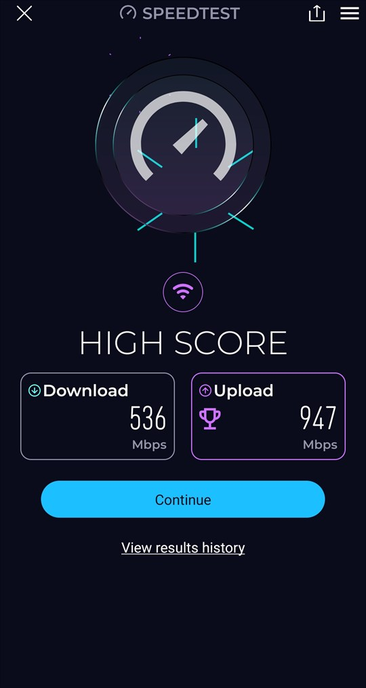

<p align="center">
  <a href="README.md"></a>
  <a href="README.fr.md"></a>
</p>

<p align="center">
  
</p>

<h1 align="center">Mergify-Net</h1>

<p align="center">
  <strong>Fusionnez tous vos réseaux — sur ordinateur et sur Android.</strong><br>
  Combinez le Wi-Fi, l'Ethernet et les partages de connexion de vos téléphones sous Windows, macOS et Linux ;
  sur Android, agrégez le Wi-Fi et les données mobiles (4G/5G) via un VPN local, sans root.
</p>

<p align="center">
  <a href="https://github.com/rohit267/mergify-net/releases/latest">Télécharger</a> ·
  <a href="#installer">Installer</a> ·
  <a href="#android">Android</a> ·
  <a href="#performance">Performance</a> ·
  <a href="#ajouter-une-deuxième-connexion">Ajouter une deuxième connexion</a> ·
  <a href="#dépannage">Dépannage</a> ·
  <a href="docs/DEVELOPING.md">Fonctionnement</a>
</p>

<p align="center">
  <a href="https://github.com/rohit267/mergify-net/actions/workflows/ci.yml"></a>
  <a href="https://github.com/rohit267/mergify-net/releases"></a>
  <a href="https://github.com/rohit267/mergify-net/releases"></a>
  <a href="LICENSE"></a>
  
</p>

<p align="center">
  
  <br>
  <sub>Un Mac en Wi-Fi + un téléphone Android. Le menu montre les deux connexions actives en même temps. <a href="docs/demo.mp4">Voir la vidéo complète de 45 secondes.</a></sub>
</p>

Mergify-Net utilise toutes vos cartes réseau en même temps. Il fonctionne sous **Windows, macOS et Linux**, et
sous **Android** (10+, sans root) il agrège le Wi-Fi et les données mobiles. C'est gratuit.
Pas de compte, pas de serveur, pas de VPN distant.

Un vrai test avec du Wi-Fi + un partage USB Android + un partage de connexion iPhone, 9 téléchargements
simultanés : **232-303 Mbit/s**. La connexion la plus rapide seule donnait environ 121 Mbit/s.

| Windows : survol de l'icône | Windows : le menu | macOS : la barre de menus |
|---|---|---|
|  |  |  |

## Ce que ça apporte

mergify-net confie chaque nouvelle connexion à l'un de vos liens. Quand une application ouvre beaucoup de
connexions, elles se répartissent sur tous vos liens.

- **Utile pour :** Steam et les téléchargements de jeux, les navigateurs, les mises à jour système, les
  envois vers le cloud (Google Drive), les gestionnaires de téléchargement comme IDM, les torrents.
- **Inutile pour :** une seule connexion. Une connexion utilise toujours un seul lien, donc un gros fichier
  venu d'une seule connexion n'accélère pas. Les navigateurs savent découper un téléchargement en plusieurs
  connexions ; voir l'astuce dans [Utilisation](#utilisation).
- **Fonctionne avec toutes les applications**, TCP et UDP, IPv4 et IPv6. Aucun proxy à configurer.
- **Intelligent :** les liens rapides reçoivent plus de connexions. Un lien sans internet n'en reçoit aucune
  tant qu'il ne fonctionne pas de nouveau.
- **Sans risque :** si mergify-net plante, votre internet continue de fonctionner.
- **Léger :** environ 0,18 cœur CPU pour 100 Mbit/s.

## Installer

**macOS et Linux** : collez ceci dans un terminal.

```
curl -fsSL https://raw.githubusercontent.com/rohit267/mergify-net/main/install.sh | sh
```

**Windows** : collez ceci dans PowerShell.

```
irm https://raw.githubusercontent.com/rohit267/mergify-net/main/install.ps1 | iex
```

C'est tout : mergify-net est installé et son icône apparaît dans la barre de menus ou la zone de
notification. Sous Linux, le script utilise votre gestionnaire de paquets (apt, dnf, zypper, apk ou pacman)
et sous macOS Homebrew si vous l'avez, ce qui permet à mergify-net de se mettre à jour avec le reste du
système. Pour le lancer à l'ouverture de session, cochez *Démarrer à l'ouverture de session* dans son menu.

<details>
<summary><strong>Vous préférez taper les commandes vous-même ?</strong> Un bloc par système, prêt à coller.</summary>
<br>

**Homebrew** (macOS) :

```
brew install rohit267/tap/mergify-net && sudo "$(brew --prefix)/bin/mergify-net" install && mergify-net tray
```

**macOS sans Homebrew** :

```
curl -fsSL https://github.com/rohit267/mergify-net/releases/latest/download/mergify-net-macos-universal.tar.gz | tar -xz -C /tmp mergify-net && sudo /tmp/mergify-net install && mergify-net tray
```

**Debian, Ubuntu, Linux Mint, Pop!_OS, Raspberry Pi OS** (apt) :

```
curl -fsSL https://rohit267.github.io/mergify-net/apt/key.gpg | sudo tee /usr/share/keyrings/mergify-net.gpg >/dev/null
echo "deb [signed-by=/usr/share/keyrings/mergify-net.gpg] https://rohit267.github.io/mergify-net/apt stable main" | sudo tee /etc/apt/sources.list.d/mergify-net.list
sudo apt update && sudo apt install -y mergify-net
```

**Fedora, RHEL, Rocky, Alma** (dnf) :

```
sudo curl -fsSL -o /etc/yum.repos.d/mergify-net.repo https://rohit267.github.io/mergify-net/rpm/mergify-net.repo && sudo dnf install -y mergify-net
```

**openSUSE** (zypper) :

```
sudo zypper addrepo https://rohit267.github.io/mergify-net/rpm/mergify-net.repo && sudo zypper --gpg-auto-import-keys install -y mergify-net
```

**Arch, Manjaro, EndeavourOS** (pacman) :

```
curl -fsSL https://rohit267.github.io/mergify-net/apt/key.asc | sudo pacman-key --add - && sudo pacman-key --lsign-key 0168C7AB77721656904811AE904F61E7F4F1C2A1
printf '\n[mergify-net]\nSigLevel = Required\nServer = https://rohit267.github.io/mergify-net/arch/$arch\n' | sudo tee -a /etc/pacman.conf
sudo pacman -Sy --noconfirm mergify-net
```

**Alpine** (apk) :

```
sudo wget -O /etc/apk/keys/mergify-net.rsa.pub https://rohit267.github.io/mergify-net/apk/mergify-net.rsa.pub
echo https://rohit267.github.io/mergify-net/apk | sudo tee -a /etc/apk/repositories && sudo apk add mergify-net
```

**Homebrew** (Linux) :

```
brew install rohit267/tap/mergify-net && sudo setcap cap_net_admin,cap_net_raw+ep "$(readlink -f "$(brew --prefix)/bin/mergify-net")"
```

**N'importe quel autre Linux** (tous CPU) :

```
curl -fsSL https://github.com/rohit267/mergify-net/releases/latest/download/mergify-net-linux-$(uname -m).tar.gz | tar -xz -C /tmp mergify-net && sudo install -m 755 /tmp/mergify-net /usr/local/bin/ && sudo setcap cap_net_admin,cap_net_raw+ep /usr/local/bin/mergify-net
```

**Windows à la main** : téléchargez [mergify-net-setup.exe](https://github.com/rohit267/mergify-net/releases/latest/download/mergify-net-setup.exe)
et lancez-le. Windows peut afficher un avertissement car l'application n'est pas encore signée : cliquez sur
*Informations complémentaires*, puis sur *Exécuter quand même*. Un
[zip portable](https://github.com/rohit267/mergify-net/releases/latest/download/mergify-net-portable.zip) est
aussi disponible.

Ensuite, démarrez-le avec `mergify-net tray` (Linux, macOS) ou depuis le menu Démarrer (Windows).
</details>

<details>
<summary><strong>Bon à savoir</strong></summary>
<br>

- **Quels CPU :** x86-64, ARM64 et Apple Silicon, ARMv7, ARMv6 (Raspberry Pi), x86 32 bits, RISC-V,
  PowerPC (ppc64le), s390x et LoongArch.
- **Aucun mot de passe demandé :** les paquets Linux donnent à mergify-net les droits réseau dont il a besoin
  (`setcap`), et sous macOS `mergify-net install` ajoute une règle pour que seul `mergify-net tray` puisse
  tourner en root sans mot de passe.
- **Icône de la zone de notification sous Linux :** nécessite un bureau compatible StatusNotifierItem : KDE,
  XFCE, Cinnamon, LXQt, Budgie, ou GNOME avec l'extension *AppIndicator and KStatusNotifierItem Support*
  (Ubuntu l'a déjà).
- **Pare-feu :** s'il bloque le trafic inconnu, faites confiance à l'interface `mergify-net`
  (par exemple `firewall-cmd --zone=trusted --add-interface=mergify-net`).
- **Dépôts signés :** apt, dnf, zypper et pacman utilisent la clé dans
  [`packaging/apt-signing-key.asc`](packaging/apt-signing-key.asc), empreinte
  `0168 C7AB 7772 1656 9048 11AE 904F 61E7 F4F1 C2A1`.
</details>

## Android

Sur un téléphone, une seule connexion à la fois est la norme. Mergify-Net pour Android embarque le même
moteur Go — compilé en bibliothèque native avec [gomobile](https://pkg.go.dev/golang.org/x/mobile) — à
l'intérieur d'un VPN local (**VpnService**). Chaque socket sortant est protégé et rattaché au bon réseau, de
sorte qu'une application ouvrant plusieurs connexions utilise **le Wi-Fi et les données mobiles (4G/5G) en
même temps**.

<table align="center">
  <tr>
    <td align="center" width="33%">
      <a href="docs/screenshots/android-dashboard-idle.jpg"></a>
    </td>
    <td align="center" width="33%">
      <a href="docs/screenshots/android-dashboard-active.jpg"></a>
    </td>
    <td align="center" width="33%">
      <a href="docs/screenshots/android-settings.jpg"></a>
    </td>
  </tr>
  <tr>
    <td align="center"><sub><b>Tableau de bord</b> — tunnel inactif, consommation de la session et cumulée, répartie Wi-Fi / mobile.</sub></td>
    <td align="center"><sub><b>Fusion en cours</b> — Wi-Fi + 4G/5G, flux et latence par lien, adresses IPv4/IPv6.</sub></td>
    <td align="center"><sub><b>Paramètres</b> — seuil de données mobiles (100 Mo → 20 Go ou illimité) et multi-flux.</sub></td>
  </tr>
</table>

<p align="center">
  <a href="docs/screenshots/android-notification.jpg"></a>
  <br>
  <sub><b>La notification permanente</b> indique le lien utilisé, le débit et le ping en direct, et permet de déconnecter le tunnel.</sub>
</p>

- **Aucun root.** Le VPN vit entièrement dans l'application et aucun trafic ne passe par un serveur ;
  Android affiche l'icône de clé VPN habituelle pendant son fonctionnement.
- **Routage intelligent.** Le lien à plus faible latence est prioritaire et porte chaque nouveau flux ;
  l'autre ne prend du trafic que lorsque le principal est saturé ou perd des paquets, si bien que les
  téléchargements et les tests de débit profitent des deux sans être tirés vers le bas par le lien le plus
  faible.
- **Vos deux liens restent les vôtres.** Rien n'est détourné à l'échelle du système : seul le trafic entrant
  dans le tunnel est réparti.
- **Notification permanente.** Le service de premier plan maintient une notification indiquant le lien
  utilisé, le débit et le ping en direct, avec une action *Déconnecter*.
- **Consommation de données.** Le tableau de bord indique le volume transporté par le tunnel pour la session
  et en cumulé, réparti entre Wi-Fi et données mobiles (4G/5G), à partir des compteurs d'octets par interface
  du moteur.
- **Paramètres.** L'engrenage en haut du tableau de bord ouvre *Paramètres* : un budget de données mobiles
  (curseur de 100 Mo à 20 Go, ou *Illimité*) conservé dans `SharedPreferences` — la boucle de statistiques
  sort les données cellulaires de la répartition (`UpdateNetworks(wifiHandle, 0)`) et prévient l'utilisateur
  dès que le volume mobile cumulé l'atteint —, plus un interrupteur pour forcer le multi-flux, qui fait
  alterner au planificateur chaque nouvelle connexion entre les deux liens au lieu de choisir le plus rapide.

Pour compiler l'app, voir la procédure complète : [Compiler la version mobile (Android)](#compiler-la-version-mobile-android)
(gomobile → `mergify.aar`, puis Gradle → APK, et installation via `adb`).

## Performance

Mesuré sur le Galaxy S25, tunnel actif :

<p align="center">
  <a href="docs/screenshots/performance-speedtest.jpg"></a>
  <br>
  <sub><b>Speedtest, tunnel actif</b> — 536 Mbit/s en réception et 947 Mbit/s en émission sur Wi-Fi + 4G/5G.</sub>
</p>

Le score suit vos liens : il correspond à ce qu'ils peuvent transporter ensemble à cet instant. Speedtest
ouvre plusieurs connexions, il profite donc des deux ; un téléchargement unique reste sur un seul lien,
comme expliqué plus haut.

## Compiler la version mobile (Android)

La version Android se compose de deux artefacts, à compiler dans cet ordre :

1. **`android/app/libs/mergify.aar`** — le moteur Go (le même que sur desktop) compilé en
   bibliothèque native pour Android via gomobile ;
2. **l'APK** de l'application Kotlin (`VpnService` + interface Jetpack Compose), produite par Gradle
   dans le dossier `android/` et qui embarque le `.aar`.

> Le `.aar` est versionné dans le dépôt : à régénérer après **chaque** modification du moteur Go
> (`internal/…`, `pkg/mobile/…`), sinon l'APK continue d'embarquer l'ancienne version.

### 1. Prérequis

| Outil | Version | Rôle |
|---|---|---|
| [Go](https://go.dev/dl/) | **1.24+** (directive `tool` du `go.mod` ; le dépôt vise actuellement Go 1.27) | compilation du moteur et des outils |
| [Android Studio](https://developer.android.com/studio) | récent | SDK Android, JDK embarqué (`jbr`), `adb` |
| `ANDROID_HOME` | pointant vers le SDK (`C:\android-sdk`, `~/Android/Sdk`…) | détecté par Gradle **et** gomobile |
| `gomobile` / `gobind` | `golang.org/x/mobile` (dernière version) | binding Go → classes Java/Kotlin |

Installer les outils Go (une seule fois), à la racine du dépôt :

```bash
# enregistre gobind comme outil du module (directive `tool` du go.mod)
go get -tool golang.org/x/mobile/cmd/gobind
go mod tidy

# le pilote gomobile et gobind sur le PATH (ce sont eux que les commandes suivantes appellent)
go install golang.org/x/mobile/cmd/gomobile@latest
go install golang.org/x/mobile/cmd/gobind@latest
```

> **Windows** : `gomobile bind` appelle `javac`. Ajoutez le JDK d'Android Studio au `PATH`
> (`%ProgramFiles%\Android\Android Studio\jbr\bin`) ou exportez `JAVA_HOME` vers ce JDK avant la
> commande. Côté Gradle, utilisez un **JDK 17 à 21** (*Settings → Build Tools → Gradle → Gradle JDK*) :
> les JBR les plus récents (24+) sont trop jeunes pour le Gradle 8.9 du projet.

### 2. Générer la bibliothèque Go (`mergify.aar`)

À la racine du dépôt (macOS/Linux) :

```bash
gomobile bind \
  -target=android/arm64 \
  -androidapi 29 \
  -javapkg mergifynet \
  -o android/app/libs/mergify.aar \
  ./pkg/mobile
```

Sous Windows PowerShell, la même commande sur une ligne :

```powershell
gomobile bind -target=android/arm64 -androidapi 29 -javapkg mergifynet -o android\app\libs\mergify.aar .\pkg\mobile
```

| Option | Signification |
|---|---|
| `-target=android/arm64` | ABI cible : le S25 est en arm64-v8a. Sans ABI (`-target=android`), le `.aar` devient multi-ABI (arm, arm64, amd64…). |
| `-androidapi 29` | API Android minimale, en cohérence avec `minSdk = 29` du Gradle. |
| `-javapkg mergifynet` | package Java généré. gobind y append le nom du package Go : les classes atterrissent dans **`mergifynet.mobile`** (`mergifynet.mobile.Mobile`), c'est ce que les imports Kotlin utilisent. |
| `-o …/mergify.aar` | fichier produit ; Gradle inclut automatiquement tout `.aar` présent dans `android/app/libs/`. |
| `./pkg/mobile` | package Go exposé à Android ; seuls des types compatibles gobind y sont exportés (règle 2 de [`AGENTS.md`](AGENTS.md)). |

### 3. Compiler l'APK Android

```bash
cd android
./gradlew assembleDebug      # Windows : .\gradlew.bat assembleDebug
```

- L'APK est produite dans `android/app/build/outputs/apk/debug/app-debug.apk` (signature de debug,
  suffisante pour un appareil de test).
- Le wrapper Gradle 8.9 est versionné (`gradlew`, `gradle/wrapper/`) : aucune installation Gradle
  globale n'est nécessaire.
- `android/gradle.properties` contient `android.overridePathCheck=true`, requis car le chemin du
  dépôt contient des accents (AGP refuse ce type de chemin sans ce réglage).
- Première exécution : Gradle télécharge ses dépendances (quelques minutes).

### 4. Installer et lancer sur l'appareil (Galaxy S25)

1. Sur le S25 : *Paramètres → À propos du téléphone → Informations sur le logiciel* — tapez 7 fois sur
   *Numéro de build* pour activer les **options pour les développeurs**, puis activez **Débogage USB**.
2. Branchez le téléphone, acceptez la clé de débogage, et vérifiez la présence de l'appareil :

   ```bash
   adb devices        # le S25 doit apparaître en état "device" (ex. R58M1234ABC    device)
   ```

3. Installer (ou mettre à jour) l'app :

   ```bash
   adb install -r android/app/build/outputs/apk/debug/app-debug.apk
   ```

4. Premier lancement : le dialogue de consentement système **VpnService** s'affiche ; une fois accepté,
   la clé VPN apparaît dans la barre d'état. L'app tourne en service au premier plan
   (`foregroundServiceType="systemExempted"` — le SDK Android ne définit **aucun** type `vpn`).
5. Suivre le démarrage du moteur Go (handles réseau Wi-Fi/cellulaire, sondes de latence, erreurs
   éventuelles de `bindSocket`) :

   ```bash
   adb logcat -s MergifyNet
   ```

L'identifiant de l'application est `com.mergify.net` ; pour la retirer de l'appareil :
`adb uninstall com.mergify.net`.

## Désinstaller

**macOS et Linux** : collez ceci dans un terminal. Cela arrête mergify-net et le retire de la façon dont il
a été installé (Homebrew, apt, dnf, zypper, apk, pacman ou le téléchargement), avec son dépôt et sa clé.

```
curl -fsSL https://raw.githubusercontent.com/rohit267/mergify-net/main/install.sh | sh -s -- uninstall
```

**Windows** : collez ceci dans PowerShell, ou utilisez *Paramètres > Applications > Applications installées >
mergify-net > Désinstaller*.

```
& "$env:ProgramFiles\mergify-net\mergify-net.exe" quit; Start-Process "$env:ProgramFiles\mergify-net\unins000.exe" '/SILENT' -Verb RunAs -Wait
```

Votre réseau redevient normal dès que mergify-net s'arrête : il supprime sa carte virtuelle et ses routes en
quittant, même après un plantage.

<details>
<summary><strong>Vous préférez taper les commandes vous-même ?</strong> Un bloc par mode d'installation.</summary>
<br>

Chaque bloc arrête d'abord l'icône de notification et désactive le démarrage à l'ouverture de session, puis
retire mergify-net.

**Homebrew** (macOS) :

```
mergify-net quit; mergify-net autostart off; sudo mergify-net uninstall; brew uninstall mergify-net && brew untap rohit267/tap
```

**macOS sans Homebrew** :

```
mergify-net quit; mergify-net autostart off; sudo mergify-net uninstall
```

**Debian, Ubuntu, Linux Mint, Pop!_OS, Raspberry Pi OS** (apt) :

```
mergify-net quit; mergify-net autostart off; sudo apt remove -y mergify-net && sudo rm -f /etc/apt/sources.list.d/mergify-net.list /usr/share/keyrings/mergify-net.gpg
```

**Fedora, RHEL, Rocky, Alma** (dnf) :

```
mergify-net quit; mergify-net autostart off; sudo dnf remove -y mergify-net && sudo rm -f /etc/yum.repos.d/mergify-net.repo
```

**openSUSE** (zypper) :

```
mergify-net quit; mergify-net autostart off; sudo zypper remove -y mergify-net && sudo zypper removerepo mergify-net
```

**Arch, Manjaro, EndeavourOS** (pacman) :

```
mergify-net quit; mergify-net autostart off; sudo pacman -R --noconfirm mergify-net && sudo sed -i '/^\[mergify-net\]$/,/^Server = .*mergify-net/d' /etc/pacman.conf && sudo pacman-key --delete 0168C7AB77721656904811AE904F61E7F4F1C2A1
```

**Alpine** (apk) :

```
mergify-net quit; mergify-net autostart off; sudo apk del mergify-net && sudo sed -i '\#rohit267.github.io/mergify-net/apk#d' /etc/apk/repositories && sudo rm -f /etc/apk/keys/mergify-net.rsa.pub
```

**Homebrew** (Linux) :

```
mergify-net quit; mergify-net autostart off; brew uninstall mergify-net && brew untap rohit267/tap
```

**N'importe quel autre Linux** (le téléchargement) :

```
mergify-net quit; mergify-net autostart off; sudo rm -f /usr/local/bin/mergify-net
```

**Windows, zip portable** : lancez `mergify-net.exe autostart off` dans son dossier, quittez l'icône de
notification, puis supprimez le dossier.

**NixOS** : retirez `programs.mergify-net` (et l'entrée `mergify-net`) de votre configuration et reconstruisez.
</details>

### NixOS

```nix
# flake.nix
inputs.mergify-net.url = "github:rohit267/mergify-net";

# configuration.nix (avec `inputs` passé via specialArgs)
imports = [ inputs.mergify-net.nixosModules.default ];
programs.mergify-net = {
  enable = true;
  autostart = true;   # facultatif : lance l'icône dans chaque session graphique
};
```

Pour l'essayer sans l'installer : `sudo nix run github:rohit267/mergify-net -- run`.

## Ajouter une deuxième connexion

mergify-net a besoin de **deux connexions réelles ou plus**. Utilisez le Wi-Fi plus l'une de ces options : un
téléphone (partage USB ou point d'accès), un câble Ethernet, ou un second Wi-Fi. Branchez-la et mergify-net
l'ajoute en quelques secondes. Quand vous la débranchez, ses connexions passent aux autres.

**Windows et Linux :** branchez le téléphone et activez le *Partage USB* (Android) ou le *Partage de connexion*
(iPhone). C'est tout.

**Mac avec un iPhone** (rien à installer)
1. Branchez l'iPhone avec un câble. Appuyez sur *Faire confiance* sur l'iPhone s'il le demande.
2. Sur l'iPhone, ouvrez *Réglages > Partage de connexion* et activez *Autoriser les autres*.
3. Un réseau **iPhone USB** apparaît sur le Mac. mergify-net l'ajoute en quelques secondes.

**Mac avec un téléphone Android** (nécessite l'app **TetherKit**)

macOS ne sait pas utiliser le partage USB Android tout seul. L'app **TetherKit** ajoute ce support.
1. Installez et ouvrez TetherKit.
2. Branchez le téléphone et activez le *Partage USB* dans les réglages du téléphone.
3. Cliquez sur **Apply** dans TetherKit. mergify-net ajoute le nouveau réseau en quelques secondes.

> **Démarrez mergify-net d'abord, puis connectez le téléphone Android.** macOS coupe la connexion TetherKit à
> chaque démarrage ou arrêt de mergify-net. Mettre en pause puis reprendre ne pose pas de problème :
> mergify-net garde sa carte virtuelle pendant la pause. Si le lien du téléphone disparaît, cliquez de nouveau
> sur **Apply** dans TetherKit. L'iPhone n'est pas concerné.

Un téléphone consomme ses données mobiles, donc une partie de votre trafic passe par lui pendant que
mergify-net tourne. Quittez mergify-net quand vous ne le souhaitez pas.

## Utilisation

1. Démarrez mergify-net. Une icône apparaît dans la zone de notification (barre de menus sur Mac).
2. L'icône est **verte** quand la fusion est active et **grise** quand elle est en pause.
3. **Il se met en pause tout seul** quand moins de deux connexions ont internet, car il n'y a rien à fusionner,
   et le menu affiche *En pause : une connexion*. Il **reprend tout seul** quand une deuxième connexion
   fonctionne. Si vous le mettez en pause ou le démarrez vous-même, ce choix l'emporte : il ne redémarrera pas
   après une pause manuelle. Décochez *Mettre en pause quand il n'y a qu'une connexion* dans le menu pour
   désactiver ce comportement, ou lancez `mergify-net tray -auto-pause=false`.
4. **Survolez** l'icône pour voir le débit de chaque connexion et le total.
5. **Clic droit** sur l'icône (sur Mac, cliquez dessus) pour ouvrir le menu. Il montre le débit de chaque
   connexion, le nombre de connexions que mergify-net lui a confiées, et les boutons *Mettre la fusion en
   pause* / *Reprendre la fusion* et *Quitter*.
6. Pour le lancer à l'ouverture de session : cochez *Démarrer à l'ouverture de session* dans le menu (ou la
   case dans l'installateur Windows, ou lancez `mergify-net autostart on`). Sur Mac, cela nécessite une fois
   `sudo mergify-net install`.

Astuces :
- Les clients torrent utilisent déjà toutes les connexions. Laissez l'interface réseau de qBittorrent sur
  *N'importe quelle interface*.
- **Téléchargements plus rapides dans le navigateur.** Un navigateur télécharge un fichier via une seule
  connexion, donc il utilise un seul lien. Chrome, Edge, Brave et les autres navigateurs Chromium peuvent le
  découper sur plusieurs connexions :
  1. Ouvrez `chrome://flags/#enable-parallel-downloading` (Edge : `edge://flags/#enable-parallel-downloading`,
     Brave : `brave://flags/#enable-parallel-downloading`).
  2. Passez *Parallel downloading* sur *Enabled* et cliquez sur *Relaunch*.

  Firefox n'a pas ce réglage ; pour les gros fichiers, utilisez un gestionnaire de téléchargement, par exemple
  `aria2c -x 8 -s 8 <lien>`. Le découpage n'aide que si le serveur autorise le téléchargement de parties d'un
  fichier, ce que font la plupart des gros sites de téléchargement.
- Laissez cochée l'option *Utiliser toutes les cartes (IPv6 seulement si toutes les cartes l'ont)*. Décochez-la
  uniquement si vous devez atteindre un site qui n'existe qu'en IPv6.
- `mergify-net list` montre quelles connexions sont utilisées et pourquoi les autres sont ignorées.
  `mergify-net status` affiche les chiffres en direct.

## Dépannage

<details>
<summary><strong>Une deuxième connexion n'accélère rien</strong></summary>
<br>

Vous ne gagnez en débit que lorsque chaque connexion atteint internet par son propre chemin. Le Wi-Fi de votre
box plus un téléphone en données mobiles fonctionne. Le Wi-Fi et l'Ethernet branchés sur le **même routeur**,
non : ils partagent une seule ligne internet, donc le total reste identique.

Rappelez-vous aussi qu'une connexion utilise toujours un seul lien. Ce sont les connexions parallèles
nombreuses (Steam, navigateurs, gestionnaires de téléchargement) qui accélèrent. Lancez
`mergify-net status` pour voir combien de connexions chaque lien porte.
</details>

<details>
<summary><strong>Une connexion n'apparaît pas</strong></summary>
<br>

Lancez `mergify-net list`. Il montre quelles connexions sont utilisées et pourquoi les autres sont ignorées, par
exemple « no default gateway » (le lien n'a pas encore internet).

- **iPhone sur un Mac :** branchez-le, appuyez sur *Faire confiance*, et activez *Réglages > Partage de
  connexion > Autoriser les autres*. Si le réseau **iPhone USB** dans *Réglages Système > Réseau* reste
  inactif, désactivez son interrupteur **Désactiver sauf si nécessaire**.
- **Android sur un Mac :** installez **TetherKit** et cliquez sur **Apply** (voir plus haut).
- **Téléphone sous Windows :** si le téléphone n'apparaît pas dans *Paramètres réseau*, installez le pilote USB
  du fabricant de votre téléphone.
</details>

<details>
<summary><strong>La connexion Android disparaît sur un Mac</strong></summary>
<br>

macOS coupe la connexion TetherKit à chaque démarrage ou arrêt de mergify-net (la pause et la reprise ne
posent pas de problème). Démarrez mergify-net d'abord, puis connectez le téléphone. Si elle disparaît,
cliquez de nouveau sur **Apply** dans TetherKit.
</details>

<details>
<summary><strong>Windows n'utilise qu'un seul réseau</strong></summary>
<br>

Windows peut couper le Wi-Fi quand un câble Ethernet est branché. Ouvrez l'éditeur de stratégie de groupe
(`gpedit.msc`), allez dans *Configuration de l'ordinateur > Modèles d'administration > Réseau > Gestionnaire de
connexions Windows*, et mettez **Réduire le nombre de connexions simultanées à Internet ou à un domaine
Windows** sur **Désactivé**.
</details>

<details>
<summary><strong>macOS dit qu'il ne peut pas ouvrir mergify-net, ou Windows affiche « Windows a protégé votre PC »</strong></summary>
<br>

Les applications ne sont pas encore signées. Sous macOS, lancez `xattr -d com.apple.quarantine mergify-net`.
Sous Windows, cliquez sur *Informations complémentaires*, puis sur *Exécuter quand même*.
</details>

<details>
<summary><strong>Le menu affiche « En pause : une connexion »</strong></summary>
<br>

mergify-net n'a de travail à faire qu'avec deux connexions ou plus ayant internet, il attend donc. Branchez ou
connectez la seconde (voir *Ajouter une deuxième connexion*) et il démarre tout seul après quelques secondes.
Pour fusionner quand même, choisissez *Reprendre la fusion* (il reste alors actif jusqu'à ce qu'une deuxième
connexion soit apparue puis repartie), ou décochez *Mettre en pause quand il n'y a qu'une connexion*.

Activer ou désactiver la fusion coupe les connexions ouvertes à ce moment-là, c'est pourquoi il attend
10 secondes sans rien qui bouge avant de se mettre en pause (2 minutes si un téléchargement ou un envoi est
encore en cours) et 3 secondes avant de reprendre, et ne bascule jamais tout seul plus d'une fois toutes les
30 secondes.
</details>

<details>
<summary><strong>Je ne trouve pas l'icône de notification</strong></summary>
<br>

Sous Windows, elle peut être derrière la flèche `^` à côté de l'horloge. Sous macOS, elle est dans la barre de
menus. Sous Linux, le bureau doit être compatible StatusNotifierItem (KDE, XFCE, Cinnamon, LXQt, Budgie, ou
GNOME avec l'extension *AppIndicator and KStatusNotifierItem Support*).
</details>

<details>
<summary><strong>Un site me demande de me reconnecter</strong></summary>
<br>

mergify-net peut utiliser une adresse IP différente pour chaque connexion, et certains sites lient votre
session à une seule IP. C'est une limite du découpage des connexions sur plusieurs liens.
</details>

## Commandes

```
mergify-net tray            icône de notification (la façon normale de le lancer)
mergify-net on | off        active / met en pause la fusion dans l'icône en cours
mergify-net quit            met en pause et ferme l'icône
mergify-net status | list   chiffres en direct / quelles connexions sont utilisées
mergify-net autostart on|off|status
mergify-net socks           proxy SOCKS5 simple sur 127.0.0.1:1080 (sans admin, par application)
mergify-net cleanup         supprime les routes restantes après un plantage
mergify-net install         macOS uniquement : `sudo mergify-net install` (voir plus haut)
```

D'autres options et détails sont dans [docs/DEVELOPING.md](docs/DEVELOPING.md).

## Bon à savoir

- Nécessite les droits administrateur (Windows), `CAP_NET_ADMIN` (Linux) ou une fois `sudo mergify-net install` (macOS).
- Certains sites lient votre session à une seule IP. mergify-net peut utiliser une IP différente pour chaque
  connexion, donc un tel site peut vous demander de vous reconnecter.
- Si vos connexions diffèrent en matière d'IPv6, les sites qui n'existent qu'en IPv6 sont inaccessibles tant que
  la case ci-dessus est cochée.

## Pour aller plus loin

- Ce qui a changé dans chaque version : [CHANGELOG.md](CHANGELOG.md)
- Fonctionnement, compilation depuis les sources, tests : [docs/DEVELOPING.md](docs/DEVELOPING.md)
- Envie d'aider ? [CONTRIBUTING.md](CONTRIBUTING.md). Un problème de sécurité ? [SECURITY.md](SECURITY.md)
- Licence : MIT, voir `LICENSE`. Composants tiers : `THIRD-PARTY-NOTICES.md`.

## Soutenir le projet

mergify-net est gratuit. S'il vous fait gagner du temps, vous pouvez [m'offrir un café](https://buymeacoffee.com/rohit267) ou [faire un don avec PayPal](https://paypal.me/champdev). Merci !

Vous montez un projet étudiant ? Hébergez-le sur [DormHost](https://dormhost.dev/?utm_source=mergify-net&utm_medium=readme-support),
également de moi : Node.js, Python ou Docker avec une base de données, 30 jours gratuits.
